<p align="center">
  <picture>
    <source media="(prefers-color-scheme: light)" srcset="assets/brand/lockup-horizontal-dark-1920x640.png">
    
  </picture>
</p>

<p align="center">
  <b>A fast Plex client for Samsung TVs.</b><br>
  Smooth scrolling, hardware playback, no dependencies.
</p>

<p align="center">
  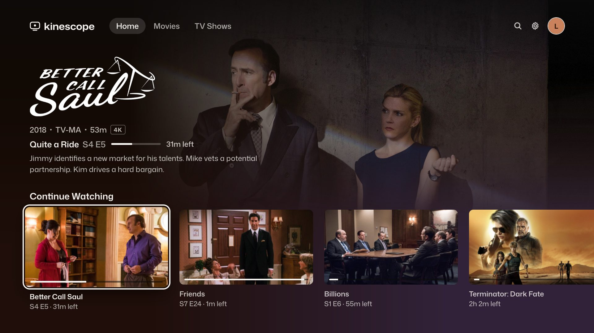
</p>

Kinescope is a Plex client for Samsung's Tizen TVs. The official Plex app on these TVs
is slow to open and lags behind the remote. Kinescope opens straight to Home and keeps
up with every key press. It's based on [SamSUCKS](https://github.com/rfaile313/samsucks)
by rfaile313.

- **Smooth.** Every animation runs on the GPU, and lists reuse a fixed set of tiles.
- **Hardware playback.** Files play directly through Samsung's video decoder. Plex
  converts only what the TV can't decode, mostly DTS audio.
- **Tiny.** Plain JavaScript, no framework, no npm, no build step.

## What's in it

- **Home.** The focused title's art and details fill the top. Plex's Home rows (Continue
  Watching, On Deck, Recently Added and more) each end in a **See all** tile that opens the
  whole row as a grid.
- **Libraries.** A poster grid with a filter bar. Filter by genre, decade, content rating
  or collection, show only unwatched titles, and sort by title, date added, release date
  or rating. CH ▲ and CH ▼ jump a letter at a time.
- **Movie and show pages.** Resume or start over, mark watched, seasons and episodes, then
  **Cast**, **Extras** (trailers and featurettes) and **More like this**.
- **Playback.** Back and forward 10 seconds, audio and subtitle tracks (including external
  subtitle files), and Skip intro. At the end of an episode, an **up-next card** counts down
  to the next one. Watch progress syncs back to Plex.
- **Hold OK** on any title for its menu: play it, mark it watched or unwatched, or
  **remove it from Continue Watching**.
- **Search.** Results appear as you type, on the on-screen keyboard or the TV's own.
  Recent searches are one press away.
- **Profiles.** Plex Home profiles, with PINs. Kinescope opens as the last profile, and
  the avatar in the top bar switches to another.

<table>
  <tr>
    <td>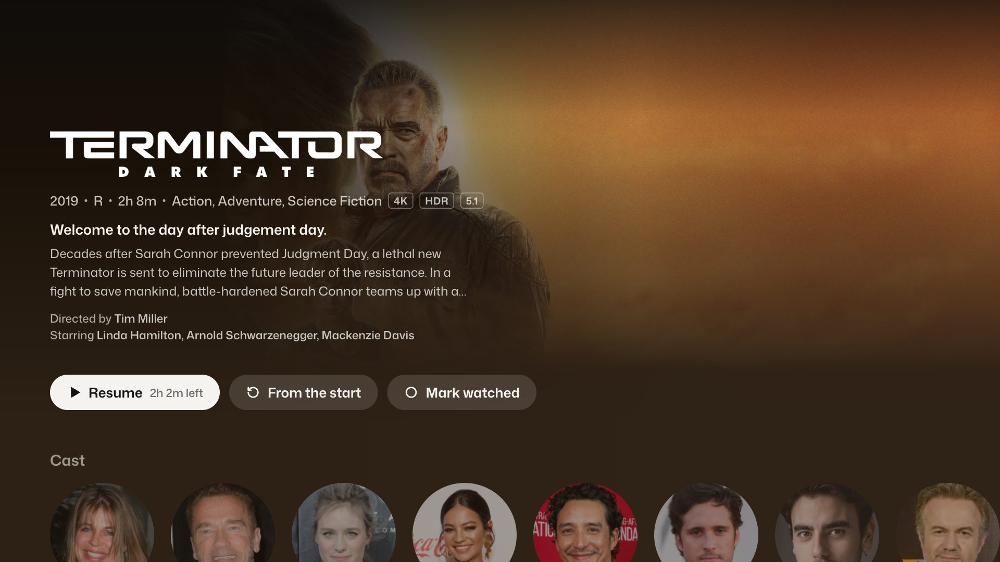</td>
    <td>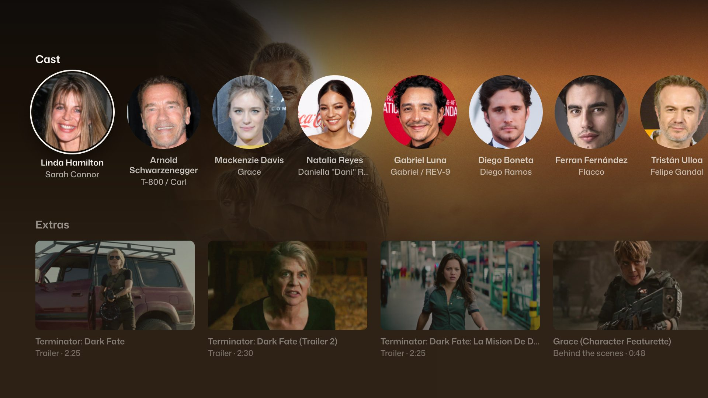</td>
  </tr>
  <tr>
    <td>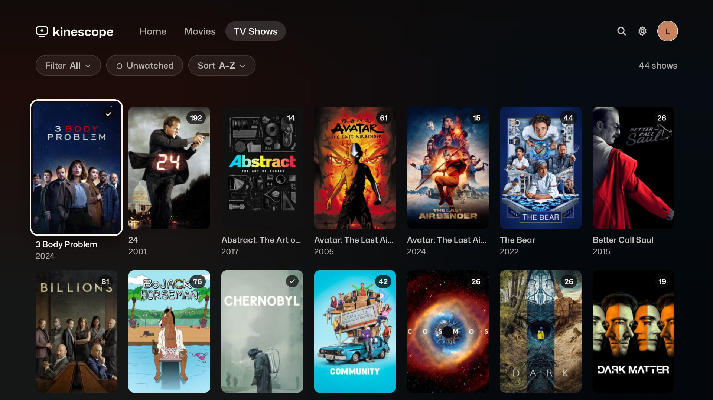</td>
    <td>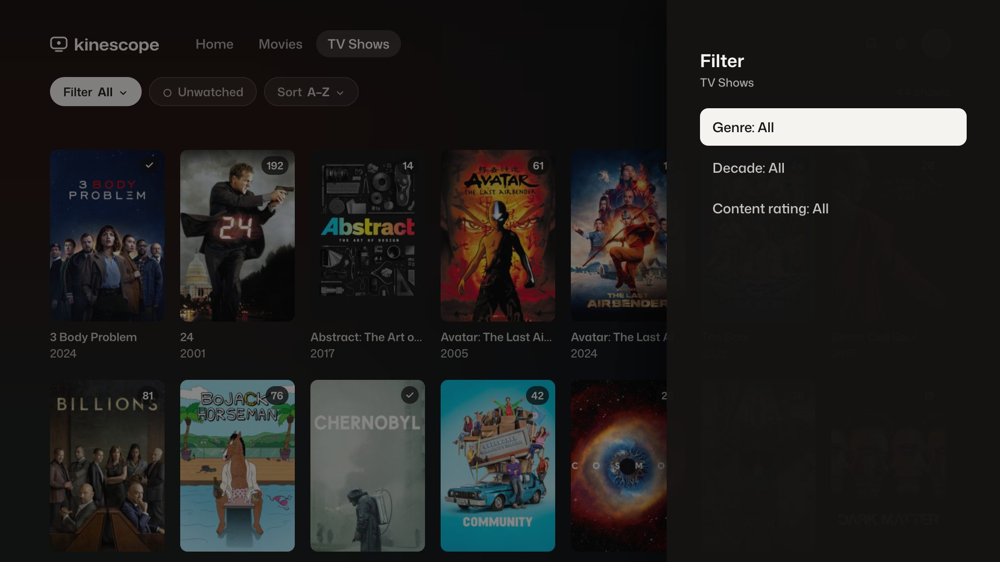</td>
  </tr>
  <tr>
    <td>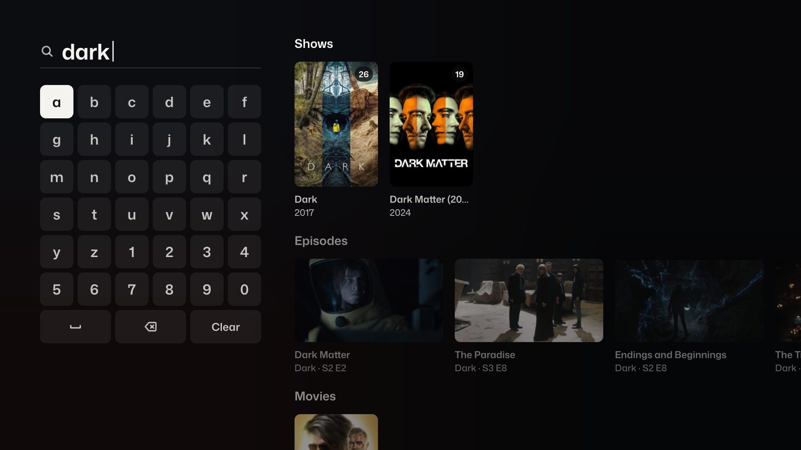</td>
    <td>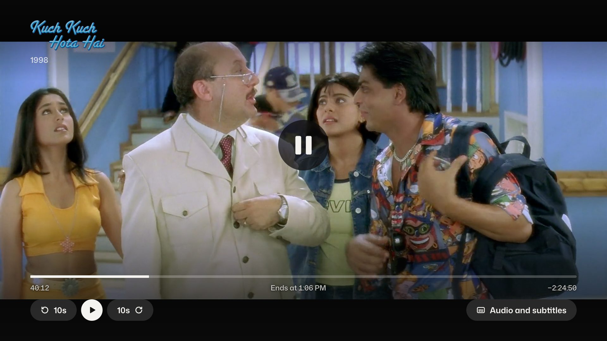</td>
  </tr>
  <tr>
    <td>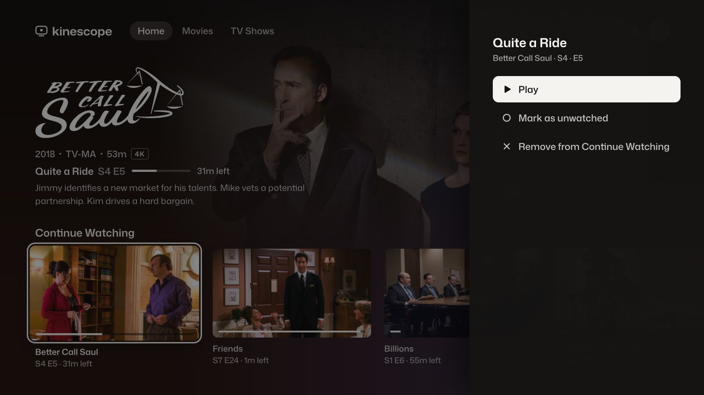</td>
    <td>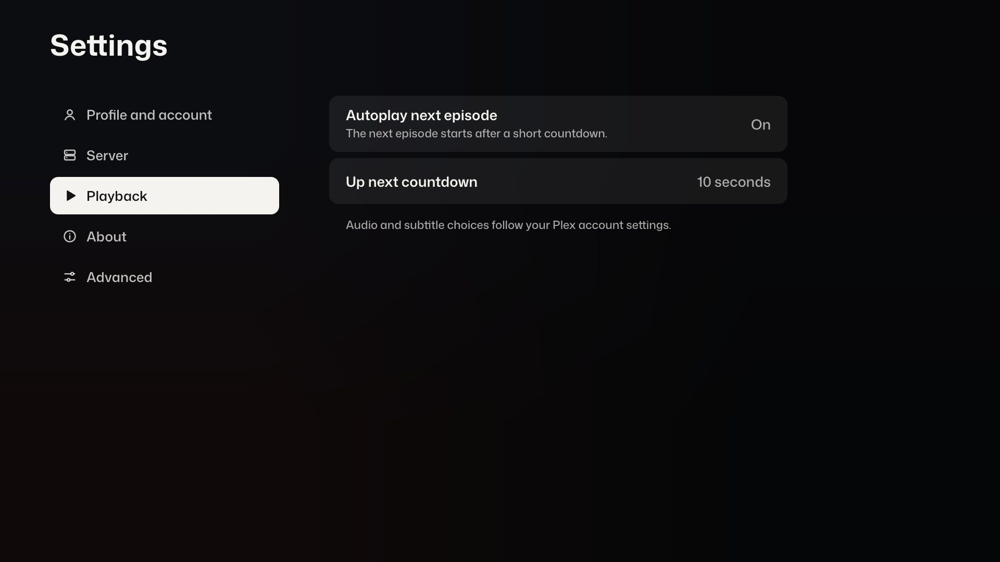</td>
  </tr>
  <tr>
    <td>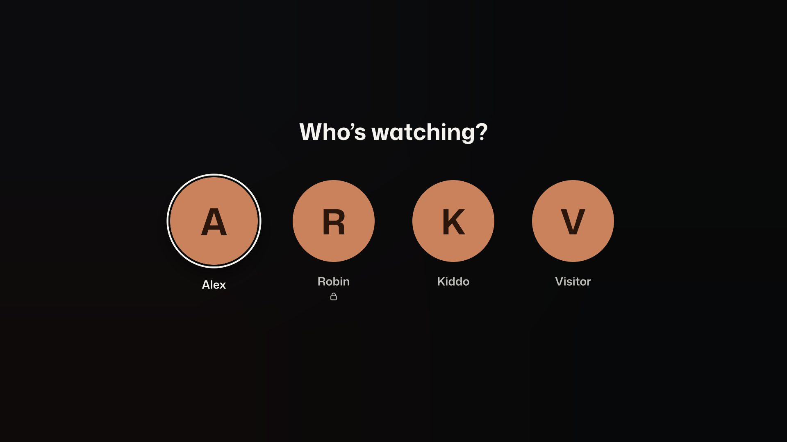</td>
    <td>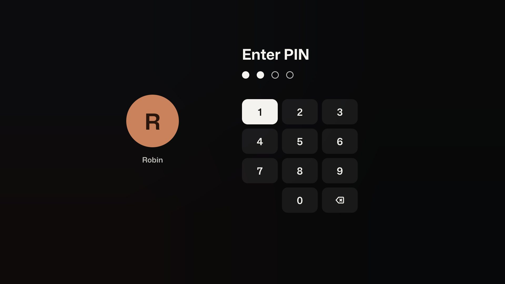</td>
  </tr>
</table>

## Install

You need:
- a Samsung smart TV (Kinescope is developed and tested on a 2023 QN90C with Tizen 9),
- a Mac or Linux computer on the same network as the TV
  (an Apple Silicon Mac also needs [Rosetta 2](https://support.apple.com/en-us/102527): `softwareupdate --install-rosetta --agree-to-license`),
- a Plex Media Server.

**1. Download Kinescope**

```sh
git clone https://github.com/dulaj-me/samsucks.git
cd samsucks
```

**2. Run setup**

```sh
./scripts/setup.sh
```

This installs Samsung's command-line tools (about 270 MB), finds your TV on the network,
and creates a signing certificate. If Developer Mode isn't on yet, it stops and tells you
what to do, including your computer's IP address. The steps are also below. Run it again
afterwards, and it skips the steps that are done.

**3. Install it on the TV**

```sh
./scripts/deploy.sh
```

Kinescope opens on the TV. Go to **[plex.tv/link](https://plex.tv/link)** on your phone and
enter the code it shows, or scan the QR code. If your account has more than one server,
pick one. That's it.

<details>
<summary><b>Turning on Developer Mode</b></summary>

1. Press **Home** on the remote and open **Apps**.
2. On the Apps screen, type **1 2 3 4 5** on the remote.
   - No number keys? Press the **123** button to bring up the on-screen keypad.
   - Nothing happened? Try again, typing a bit faster.
3. Switch **Developer mode** to **On**, and enter your computer's IP address
   (`./scripts/setup.sh` prints it).
4. Choose **OK**, then restart the TV: hold the **Power** button until it turns off and back on.

When it's on, the Apps screen shows **Develop mode** at the top.
</details>

### Opening it later

Press **Home** → **Apps** and scroll to the bottom, where your installed apps are.
To pin it to the home bar, highlight **Kinescope**, open its options (hold **OK**) and
choose **Add to Home**.

### Troubleshooting

| Problem | Fix |
| --- | --- |
| Typing 12345 does nothing | Make sure you're on the **Apps** screen. Use the on-screen keypad (**123** button) if your remote has no number keys, and type quickly. |
| Setup says it needs Rosetta 2 | Samsung only ships Intel tools for macOS. Run `softwareupdate --install-rosetta --agree-to-license`, then `./scripts/setup.sh` again. |
| Setup says "No Samsung TV found" | Turn the TV on and make sure it's on the same network (Wi-Fi or Ethernet) as your computer. |
| Setup says Developer Mode points at another IP | Re-enter your computer's IP in the Developer Mode popup, then restart the TV. |
| "Can't reach the TV" when deploying | Restart the TV, then run `./scripts/setup.sh` again. Your computer's IP may have changed. |
| The app disappeared | TV firmware updates can remove sideloaded apps. Run `./scripts/deploy.sh` again. |
| The sign-in code expired | Press **OK** on **New code**. |

## Using it

| Remote | What it does |
| --- | --- |
| Arrows, OK | Move, select |
| Hold OK | The focused title's menu: Play, Mark watched or unwatched, and Remove from Continue Watching on that row |
| Play/Pause | Play the focused title |
| Back | Go back. At Home, press it twice to exit |
| ▲ from the top row | Top bar: Home, your libraries, Search, Settings and your profile |

In a library:

| Remote | What it does |
| --- | --- |
| ▲ from the first row | Filter bar: Filter, Unwatched, Sort |
| Yellow | Next sort order |
| CH ▲ / CH ▼ | Previous or next letter |

While watching:

| Remote | What it does |
| --- | --- |
| OK | Show the controls; with them showing, pause or play |
| ▼ | Controls: back 10s, play/pause, forward 10s, audio and subtitles, next episode |
| ◀ ▶ | Seek. Keep pressing for bigger steps |
| ▲ | Hide the controls |
| CH ▲ / CH ▼ | Next or previous episode |
| Back | Hide the controls, then stop |

On a show page, **Info** on an episode opens that episode's own page. On a recent search,
hold OK to remove it or clear them all.

**Settings** has profile switching and sign-out, the server, Playback (autoplay the next
episode, and an up-next countdown of 5, 10, 15 or 30 seconds), About, and Advanced.

## Why it's fast

Samsung TVs only run web apps, but there's nothing slow about the web engine if you
treat it like a game engine:

- Every animation is a GPU transform or fade. Nothing big is ever repainted.
- Lists reuse a fixed set of tiles instead of creating new ones as you scroll.
- The focus card stays still. The row slides under it.
- A held key can never queue up work: input is applied at most once per frame.
- Plex resizes every image to exactly the pixels on screen before it's sent.
- Video goes straight to Samsung's hardware decoder. Plex passes the video through and
  converts only what the TV can't decode, mostly DTS audio.

The background behind every screen is a 2×2-pixel WebGL texture that the GPU stretches to
fill the screen. A full-screen CSS gradient looks the same but took almost two seconds to
repaint on the 2022 Samsung Q60B where SamSUCKS was first measured. To see the difference,
**Settings → Advanced → Demo: original slow renderer** turns the gradient back on, and
**Settings → Advanced → Performance overlay** shows the frame rate.

## For developers

<details>
<summary><b>Dev loop: logs, remote control and benchmarks on the real TV</b></summary>

Chrome DevTools can't attach to a retail TV, so dev builds talk to a small server on
your computer instead. Put your computer's `host:port` in `.env` as `DEV_HOST`, then:

```sh
node tools/devserver.mjs          # receives logs and perf samples from the TV (build/tv.log)
./scripts/deploy.sh --dev         # dev build: performance overlay, logging, remote control

curl 'localhost:8790/send?keys=down,right,right,enter'       # press buttons
tools/tveval.sh 'document.title'                              # run JS on the TV, print the result
tools/tveval.sh '__bench(["right","right","left","left"], 250)'   # frame stats while replaying keys
tools/tveval.sh "__css('.hero-art{display:none}')"           # A/B test a CSS change live
tools/bench.sh                    # fixed scenarios, 3 runs each; compare with docs/perf-baseline.md
tools/bench.sh info cold          # TV model and user agent; reload-to-Home-rows time
tools/perf-lint.sh                # the CSS performance rules: transform and opacity only, no filters
```

With `DEV_SKIP_LOGIN=1` and `PLEX_SERVER_URL` in `.env`, dev builds skip sign-in and
use a server that allows unauthenticated local-network access.
</details>

<details>
<summary><b>Running it in desktop Chrome</b></summary>

The UI also runs in desktop Chrome, the quickest way to work on layout. No build is needed:

```sh
npx -y http-server app -p 8123 -c-1   # then open http://localhost:8123
```

`-c-1` turns off caching, so a reload picks up your edits. Avoid `python3 -m http.server`:
it drops connections when Chrome requests every module at once, and the app hangs on the
splash screen.

To skip sign-in and see your real libraries, add `PLEX_SERVER_URL` and `PLEX_TOKEN` to
`.env` and run `node tools/preview.mjs` instead. It serves `app/` as a dev build and
proxies Plex through `/pms`, adding the token on the way out, so the browser never sees
it. plex.tv calls are answered from `tools/fixtures/plextv.json`: four made-up profiles,
where Robin's PIN is 1234. Each checkout gets its own port; `PORT=` and `ENV_FILE=`
override the port and the `.env` path. Playing something reports progress to your
server, like any other client.

On a keyboard: arrows and Enter (hold for the menu), Backspace or Esc for Back, Space
for Play/Pause, Page Up and Page Down for CH ▲ and CH ▼, and the number keys for a PIN.
Playback uses a plain `<video>` element instead of AVPlay, with no track picker, so check
anything player-related on the TV.
</details>

<details>
<summary><b>How the code is laid out</b></summary>

```
app/            the whole TV app; deploy.sh copies it to build/app and packages it
  js/screens/   home, hub, library, detail, player, search, settings, profiles, login
  js/ui/        rows, grids, tiles, focus card, side menu, keyboard, backdrop, toast, perf overlay
  js/plex/      plex.tv sign-in and the Plex Media Server API
  js/platform/  Tizen keys and device info, AVPlay / <video> player
  css/          design tokens, shared components, one stylesheet per screen
scripts/        setup.sh (one-time), deploy.sh (build and install), make-brand.py
tools/          dev server, TV eval, network remote, preview proxy, benchmarks, perf lint
docs/           the performance baseline and these screenshots
DESIGN.md       the visual system: colour, type, layout, motion and the performance rules
```

There's no bundler. The TV's browser (Chromium 120 on Tizen 9) runs ES modules natively,
and `deploy.sh` adds `<link rel="modulepreload">` tags so every module loads in parallel.
</details>

<details>
<summary><b>Plex server quirks</b></summary>

- Plex Media Server 1.42 returns `400` for `start.m3u8` unless
  `/video/:/transcode/universal/decision` was called for the same session first.
- `X-Plex-Platform=Tizen` selects the server's built-in profile for the official app,
  which rejects these transcode requests, so Kinescope identifies itself as `Samsung`.
- Samsung TVs from 2018 on can't decode DTS. For those files Plex copies the video
  and converts only the audio, to AC3 5.1.
- Burning in a subtitle re-encodes the video, which at 4K runs below realtime on most
  servers. Embedded text subtitles are requested as `subtitles=segmented` with a WebVTT
  `subtitleProfile` target instead: Plex keeps copying the video and adds a WebVTT
  subtitle rendition that AVPlay shows. 4K never burns.
- A copied HLS stream starts on the keyframe before the requested offset, sometimes
  10 s earlier. The real start is `minOffsetAvailable` on `/transcode/sessions/<session>`.
</details>

## Credits

Kinescope is based on [SamSUCKS](https://github.com/rfaile313/samsucks) by rfaile313,
which was inspired by [plx-native](https://github.com/GLinnik21/plx-native), a native Plex
client for LG TVs. Font: Kinescope Sans, based on [Mona Sans](https://github.com/github/mona-sans)
by GitHub (SIL Open Font License). QR codes: [qrcode-generator](https://github.com/kazuhikoarase/qrcode-generator)
by Kazuhiko Arase (MIT).

Kinescope is an independent project, not affiliated with Plex or Samsung.

## License

Copyright © 2026 rfaile313. Kinescope is free software, released under the
[GNU General Public License v3.0](LICENSE): you can use, study, change and share it,
and anything you distribute that's built on it must stay open source under the same
license.
